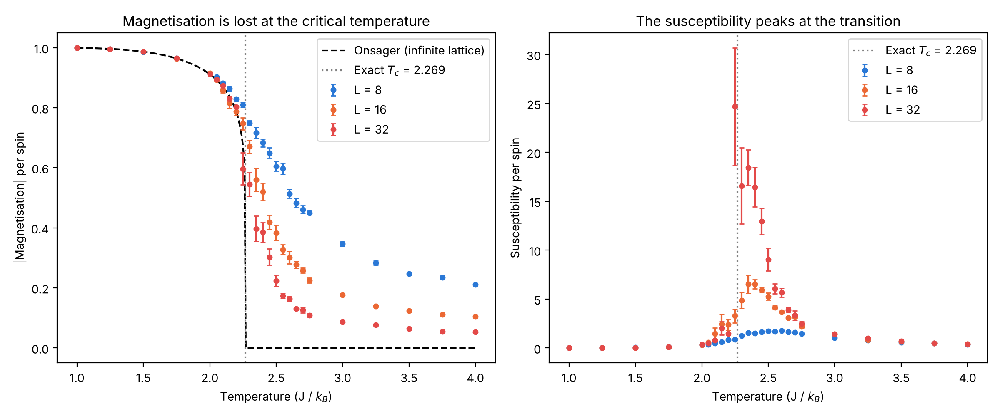
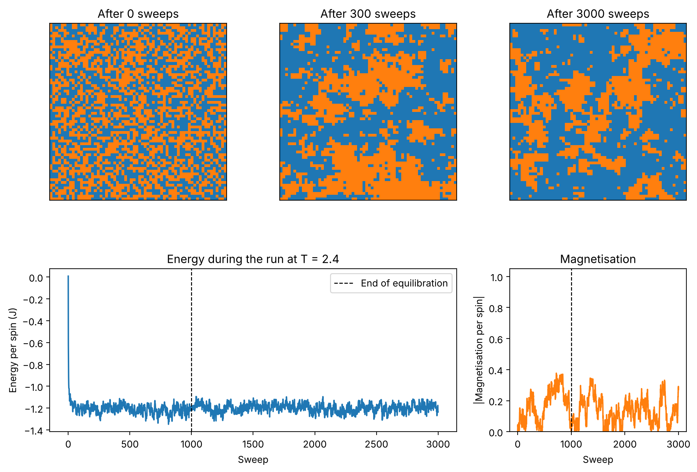

# 2D Ising Model: Magnetisation Lost at the Critical Temperature

A Monte Carlo simulation of the 2D Ising model on a square lattice. It shows a ferromagnet losing its magnetisation at the critical temperature, and how the results for a finite lattice approach Onsager’s exact solution for an infinite lattice as the lattice gets larger.



## Why this model

While looking ahead at my second-year university modules, I came across examples of statistical mechanics explaining easily observable behaviour of real materials. The one that caught my eye was that magnetic moments flip with probabilities that depend on temperature (Mandl, 1988, Ch. 3). I had often read about the Curie temperature, where a ferromagnet loses its magnetism, but could never understand why heating a magnet would cause this. That made me want to build my own simulation of the simplest model of a ferromagnet, the Ising model, to show this probabilistic spin flipping in action.

This project reinforced my interest in condensed matter physics, because it shows how small-scale statistical effects create large-scale properties that we rely on in many ways. The same idea drives modern condensed matter research, such as the work on 2D materials at the University of Manchester, which I hope to get involved with during my degree. One example that links directly to this project is chromium triiodide (CrI₃): Huang et al. (2017) showed that a single atomic layer of it stays ferromagnetic, because its spins prefer to point out of the plane, which makes it a real-world example of a 2D Ising-like magnet.

The Ising model is a model of a 2D lattice of spin sites arranged in a uniform pattern so that all particles have 4 neighbour sites. Each spin can either take spin up or spin down and neighbouring spins tend to line up with each other. Below the critical temperature the preference to line up is dominant and the magnetic moments add up to create what we see as a permanent ferromagnet. However, above the critical temperature, the thermal fluctuations cause the order to break down leading to a random assortment of spins that tend to cancel and leave no net magnetisation. The 2D Ising model is important as Onsager solved it exactly in 1944, allowing for the simulation to be checked against confirmed values. 

## The physics

The energy of a configuration of spins $s_i = \pm 1$ is

$$
E = -J \sum_{\langle i,j \rangle} s_i s_j ,
$$

where the sum is over nearest-neighbour pairs and $J > 0$, so aligned neighbours have lower
energy. The code uses units with $J = k_B = 1$.

Onsager's exact critical temperature for an infinite lattice is

$$
T_c = \frac{2J}{k_B \ln\left(1 + \sqrt{2}\right)} \approx 2.269 ,
$$

and below $T_c$ the exact magnetisation per spin (announced by Onsager, proved by Yang in
1952) is

$$
M = \left[ 1 - \sinh^{-4}\left(\frac{2J}{k_B T}\right) \right]^{1/8} ,
$$

which falls to zero at $T_c$. The susceptibility $\chi$ measures how much the magnetisation
fluctuates. For an infinite lattice it diverges at $T_c$, and on a finite lattice it shows a
peak instead.

## Method

- **Metropolis algorithm.** A spin is picked at random and flipped if the flip lowers the
  energy, or otherwise with probability $e^{-\Delta E / k_B T}$. One sweep is $N$ attempted
  flips, where $N = L^2$ is the number of spins.
- **Periodic boundaries.** The lattice wraps around like the surface of a torus, so every
  spin has four neighbours.
- **Equilibration.** The first sweeps are discarded while the lattice settles. The scan
  starts every run with all spins aligned, which avoids long-lived stripe states that random
  starts can get stuck in below $T_c$.
- **Error bars.** Consecutive sweeps are correlated, so they cannot be treated as independent
  samples. The measurement sweeps are split into 10 blocks and the errors come from a
  blocked jackknife, which also works for the susceptibility (a variance, not a mean).
- **Drift check.** If the averages in the first and second halves of the measurement sweeps
  differ by more than 3 standard errors, the run is flagged as not yet in equilibrium.
- **Observables.** Energy per spin, $\langle |m| \rangle$, and
  $\chi = N\left(\langle m^2 \rangle - \langle |m| \rangle^2\right) / k_B T$.
  On a finite lattice the signed $\langle m \rangle$ averages to zero, because the whole
  lattice occasionally flips between mostly up and mostly down, so $|m|$ is used instead.

## Results

**Below $T_c$ the simulation matches Onsager's exact result.** Nothing is fitted. At
$T = 2.0$ all three lattice sizes give $\langle |m| \rangle = 0.913$–$0.915$, against the
exact $0.911$.

**Above $T_c$ the magnetisation goes to zero as the lattice grows.** A finite lattice keeps a
small leftover magnetisation even when it is disordered. Far above $T_c$, spins are only
correlated over short distances, so the lattice behaves like many independent patches. The
sum of $N$ random $\pm 1$ contributions grows like $\sqrt{N}$, so $|m| \propto 1/\sqrt{N} = 1/L$.
The data follow this closely:

| $L$ | $\langle \lvert m \rvert \rangle$ at $T = 4.0$ |
|---|---|
| 8 | 0.211 |
| 16 | 0.104 |
| 32 | 0.052 |

Each doubling of $L$ halves $|m|$. For an infinite lattice the leftover magnetisation
vanishes and the sharp transition at $T_c$ is recovered.

**The susceptibility peak grows and moves towards $T_c$ as $L$ increases.** For an infinite
lattice $\chi$ diverges at $T_c$. On a finite lattice the correlation length cannot grow
beyond $L$, so the divergence is cut off and becomes a peak. Finite-size scaling predicts a
peak height $\chi_{\max} \propto L^{\gamma/\nu} = L^{7/4}$, using the exact 2D exponents
$\gamma = 7/4$ and $\nu = 1$. So doubling $L$ should multiply the peak by
$2^{7/4} \approx 3.36$.

| $L$ | Peak $\chi$ | Peak position |
|---|---|---|
| 8 | 1.75 ± 0.04 | broad, about 2.5–2.6 |
| 16 | 6.5 ± 0.9 | 2.35–2.4 |
| 32 | about 16–25 | 2.25–2.4 (within errors) |

From $L = 8$ to $16$ the peak grows by $3.7 \pm 0.5$, consistent with $3.36$. The $L = 32$
points near $T_c$ are too noisy to give a clean ratio (see Limitations): the four points
from 2.25 to 2.4 are consistent within their error bars, so the highest one, at 2.25, does not pin
down the peak position. The peak position is also predicted to shift towards $T_c$ as
$L^{-1/\nu} = 1/L$, and the data move that way, from a broad maximum near 2.5–2.6 for
$L = 8$ to close to $T_c$ for $L = 32$.

**Random starts can get stuck in stripe states.** The most surprising thing I found was that if the simulation is started from random spins below $T_c$, the lattice can settle into two bands, one of up spins and one of down spins, separated by two straight domain walls that wrap all the way round the lattice. In one run at $L = 32$ and $T = 1.5$ this lasted over 2000 sweeps. The walls are long-lived because their energy depends only on their length: moving a straight wall sideways doesn’t make it shorter, so there is no energy to gain and nothing drives the two walls together. They only drift through thermal fluctuations until they meet and annihilate. At zero temperature this never happens, and a random start ends up permanently stuck in stripes about a third of the time. This is why the scan starts every run with all spins aligned.

## A single run



An $L = 64$ lattice at $T = 2.4$, just above $T_c$, starting from random spins (orange is
−1, blue is +1). Within a few hundred sweeps the spins form clusters of many different sizes.
That is the large correlation length near a critical point. The lattice has no overall
magnetisation, but at any moment it can be noticeably more one colour than the other.

## Limitations

- **Critical slowing down.** Near $T_c$ the Metropolis algorithm takes a long time to
  produce independent configurations. The correlation time grows roughly as $L^{z}$ with
  $z \approx 2.17$. For $L = 32$ near $T_c$ it reaches hundreds of sweeps, so those points
  are the noisiest in the figure, and running the same temperature with a different seed
  moves the peak height by about 15%. The drift check catches the worst cases: at $L = 64$ and $T = 2.3$, 1000 equilibration sweeps were not enough. Cluster algorithms such as Wolff's flip whole clusters at once and avoid most of this slowing down.
- **False alarms from the drift check.** The check is a 3-standard-error test on only 5
  blocks per half, so a few percent of perfectly good runs are flagged by chance. In the
  figure above it flagged $L = 32$ at $T = 4.0$, where the correlation time is only a few
  sweeps, so that warning is a false alarm.
- **Speed.** The Metropolis loop is plain Python, so the full scan takes about 15 minutes.
- **Lattice sizes.** With only three sizes and a temperature step of 0.05, the peak positions
  give a rough check of finite-size scaling rather than a precise fit.

## Running it

Needs Python 3 with NumPy and Matplotlib (tested with Python 3.13).

```bash
pip install -r requirements.txt

python ising.py         # one run: asks for lattice size, temperature and sweeps
python ising_scan.py    # temperature scan for L = 8, 16, 32 (about 15 minutes)
pytest                  # run the tests
```

`ising.py` saves its figure as `ising_run.png` and `ising_scan.py` saves `ising_scan.png`.
The scan uses a fixed random seed, so it reproduces the figure at the top of this page.

## Tests

The tests in `test_ising.py` check the physics as well as the code:

- the energy of a fully aligned lattice is exactly $-2J$ per spin
- the fast single-spin energy change matches a full recalculation, including at the edges
- a cold lattice stays ordered and a hot one becomes disordered
- the average energy at $T = 3$ agrees with Onsager's exact value of $-0.8173$
- the jackknife error for independent data matches $\sigma / \sqrt{n}$
- the exact magnetisation formula gives the known values, and zero above $T_c$
- the drift check flags a rising magnetisation but not a steady one
- too few measurement sweeps gives a clear error

## Files

| File | What it does |
|---|---|
| `ising.py` | The simulation, the error analysis and a single interactive run |
| `ising_scan.py` | Temperature scan for several lattice sizes, compared with Onsager |
| `test_ising.py` | Tests, run with `pytest` |
| `conftest.py` | Makes the tests use a non-interactive plotting backend |
| `figures/` | The figures shown in this README |

## References

- F. Mandl, *Statistical Physics*, 2nd ed., Manchester Physics Series
  (Wiley, Chichester, 1988).
- L. Onsager, *Crystal Statistics. I. A Two-Dimensional Model with an Order-Disorder
  Transition*, Phys. Rev. **65**, 117 (1944).
- C. N. Yang, *The Spontaneous Magnetization of a Two-Dimensional Ising Model*,
  Phys. Rev. **85**, 808 (1952).
- V. Spirin, P. L. Krapivsky and S. Redner, *Freezing in Ising ferromagnets*,
  Phys. Rev. E **65**, 016119 (2001).
- B. Huang et al., *Layer-dependent ferromagnetism in a van der Waals crystal down to the monolayer limit*, Nature **546**, 270 (2017).


## Licence

MIT. See [LICENSE](LICENSE).